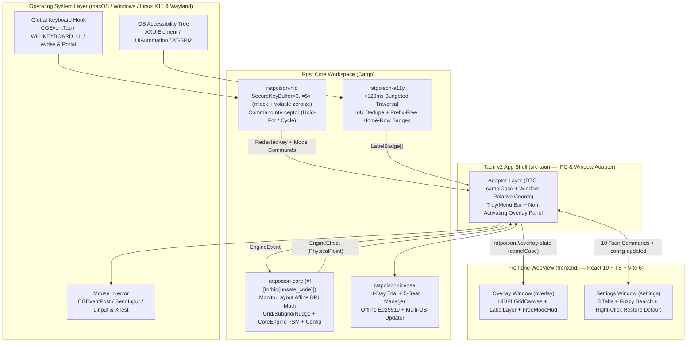

# RatPoison — Unified Clone Architecture Document

> **Project**: RatPoison — Rust + Tauri v2 Keyboard-Driven Mouse Control Utility (Clone of [mouseless.click](https://mouseless.click))  
> **Repository**: `https://github.com/emrisca/RatPoison`  
> **Canonical App ID**: `io.github.emrisca.RatPoison`  
> **Orchestrator Synthesis**: Synthesized from 6 parallel engineering swarm deliverables (`docs/swarm/01-*.md` through `06-*.md`) and independently verified across the Rust Cargo workspace (`97/97` passing tests (`94` workspace + `3` Tauri shell), `0` Clippy warnings) and Vite/React frontend (`0` TypeScript errors).

---

## 1. Executive Architecture Overview

RatPoison replaces physical mouse navigation with three ultra-low-latency, keyboard-driven interaction modes backed by a memory-safe **Rust** core and a lightweight **Tauri v2** transparent overlay & settings shell:

1. **Grid / Overlay Mode**: Two-character case-sensitive NxM screen tiling → nested 3×3 Subgrid zoom → sub-pixel nudging → click/drag/scroll, with multi-monitor mixed-DPI affine coordinate projection.
2. **Free Mode**: Overlay-free relative cursor movement (`I`, `J`, `K`, `L`), scrolling, and stacked speed modifiers (`A`, `S`, `D`, `F`) with unit-normalized diagonals and power ease-in acceleration curves.
3. **Label Mode**: On-demand OS accessibility tree traversal (`AXUIElement` on macOS, `UIAutomation` on Windows, `AT-SPI2` on Linux) inside a strict `<120ms` SLA, projecting collision-free, prefix-free home-row hint badges onto every clickable UI element.

### System Architecture Diagram

---

## 2. Workspace Crate & Deliverable Map

| Subsystem | Owner | Location | Verification Status | Detailed Spec |
| :--- | :--- | :--- | :--- | :--- |
| **UI/UX & Frontend** | Sub-Agent 1 | `frontend/`, `src-tauri/tauri.conf.json`, `src-tauri/capabilities/default.json` | `tsc --noEmit && vite build` passed (`0` errors, `893ms`) | [01-ui-ux-frontend.md](swarm/01-ui-ux-frontend.md) |
| **Core Engine & Algorithms** | Sub-Agent 2 | `crates/ratpoison-core/` (`#![forbid(unsafe_code)]`) | `30/30` tests passed, `0` Clippy warnings | [02-core-engine-algorithms.md](swarm/02-core-engine-algorithms.md) |
| **Input/HID & Security** | Sub-Agent 3 | `crates/ratpoison-hid/` | `29/29` unit tests + `4/4` `compile_fail` doctests passed, `0` Clippy warnings | [03-input-hid-security.md](swarm/03-input-hid-security.md) |
| **Cross-Platform & A11y** | Sub-Agent 4 | `crates/ratpoison-a11y/`, `packaging/flatpak/` | `7/7` tests passed, `0` Clippy warnings | [04-cross-platform-a11y.md](swarm/04-cross-platform-a11y.md) |
| **Licensing & DevOps** | Sub-Agent 5 | `crates/ratpoison-license/`, `.github/workflows/release.yml` | `5/5` test suites passed, `0` Clippy warnings, valid YAML | [05-licensing-update-devops.md](swarm/05-licensing-update-devops.md) |
| **Testing & QA Audits** | Sub-Agent 6 | `crates/ratpoison-tests/` | `19/19` integration & security tests passed, `0` Clippy warnings | [06-testing-qa.md](swarm/06-testing-qa.md) |
| **Tauri v2 App Shell** | Orchestrator | `src-tauri/` (`Cargo.toml`, `src/{ipc,bridge,lib,main}.rs`, `icons/*`) | `3/3` tests passed, `0` Clippy warnings, binary built (`ratpoison`) | This document |
| **Project Total** | Orchestrator | Workspace + `src-tauri/` + `frontend/` | **`97/97` Rust tests + clean Vite build + `0` Clippy warnings** | This document |

---

## 3. Core Subsystem Architecture

### 3.1 UI/UX & Click-Through Overlay (`frontend/`, `src-tauri/`)
- **Two-Window Tauri v2 Design**:
  - `overlay`: Frameless, transparent, always-on-top, non-focusable (`focus: false`), `skipTaskbar: true`, `visibleOnAllWorkspaces: true`, `shadow: false`, hidden at boot (`visible: false`) with `macOSPrivateApi: true`.
  - `settings`: Standard decorated window (`1000×680`, min `780×540`) hosting 8 tabs (`General`, `Grid`, `Free Mode`, `Label Mode`, `Keybindings`, `Appearance`, `Licensing`, `Updates`).
- **Sub-Frame Latency Budget (`<16ms` / 60–120Hz)**:
  - `GridCanvas.tsx` draws the full NxM grid, case-sensitive 2-char prefix dimming/highlighting, nested 3×3 Subgrid zoom inset, and nudge crosshair on a single HiDPI-scaled `<canvas>` (DPR-aware) driven by a transient Zustand subscription (`useOverlayStore.ts`) bypassing React tree reconciliation.
  - `LabelLayer.tsx` renders collision-aware accessibility badges with SVG leader lines when badges are displaced from tight anchors.
  - `FreeModeHud.tsx` displays an unobtrusive HUD pill for `I/J/K/L` vectors and `A/S/D/F` speed/drag/scroll modifiers.
- **Searchable Settings & Right-Click Restore Default**:
  - `⌘K` / `/` focuses a live fuzzy/substring scorer (`scoreSettingMatch`) filtering every setting across all 8 tabs simultaneously.
  - Every `SettingRow` tracks deviation from `DEFAULT_CONFIG` with a modified indicator dot and opens `RestoreContextMenu` on right-click (`onContextMenu`) to invoke `reset_setting_key` for that single dot-notation key without clobbering sibling preferences.
  - Live `LiveOverlayPreview` reflects color, opacity, line width, font family, and font weight edits instantaneously.

### 3.2 Core Engine, Mixed-DPI Math & State Machine (`crates/ratpoison-core`)
- **Zero-Unsafe Core**: `#![forbid(unsafe_code)]` across the entire mathematical and state-machine engine.
- **Per-Monitor Affine DPI Projection (`geometry.rs`)**:
  - Avoids global-origin scale multiplication bugs on mixed-DPI virtual desktops (including negative origins and portrait monitors):
    $$P_x = M_{\text{phys},x} + \operatorname{round}\!\bigl((L_x - M_{\text{log},x}) \cdot s_M\bigr), \qquad L_x = M_{\text{log},x} + \frac{P_x - M_{\text{phys},x}}{s_M}$$
  - Uses half-open monitor containment `[x, x + w) × [y, y + h)` and edge-safe clamping (`x_max = x + w - 1e-6`, physical `x + w - 1`) to prevent cross-monitor seam spillover, plus L-shaped dead-space nearest-monitor projection.
- **Edge-Exact Grid, Subgrid & >676 Cell Support (`grid.rs`)**:
  - Computes cell edges via cumulative fractional partitioning (`x0 = rect.x + (col * width) / cols`, `x1 = rect.x + ((col + 1) * width) / cols`), eliminating floating-point drift gaps across 4K/5K canvases.
  - Supports case-sensitive mixed-case alphabets (`52 × 52 = 2,704` unique 2-character codes) in both `RowColIndexed` and `Sequential` layouts, verified up to `40×30 = 1,200` cells.
- **Deterministic State Machine & Presets (`state_machine.rs`, `presets.rs`)**:
  - Pure `CoreEngine::handle_event(EngineEvent) -> StepOutput { effects: Vec<EngineEffect>, snapshot }` supporting `Normal → Grid → Subgrid → Nudge`, `Normal ↔ FreeMode`, and `Normal ↔ LabelMode`.
  - **Drag Safety Invariant**: Any `Escape` or exit to `Normal` while dragging unconditionally emits `EngineEffect::MouseUp` before clearing state so no OS mouse button ever sticks.
  - **Quick Select + Free Mode Workflow**: Built-in presets (`standard`, `quick_select_free`, `precision_design`) with app-scoped and display-scoped overrides resolved deterministically via `resolve_preset`.
- **Forward-Compatible Config Preservation (`config.rs`)**:
  - `RatPoisonConfig` embeds `#[serde(flatten, default)] pub unknown_fields: BTreeMap<String, serde_json::Value>` so future or hand-edited keys survive read-modify-write cycles untouched.
  - Single-key `restore_default(dot_path)` covers all 47 canonical keys in `KNOWN_SETTING_KEYS`.

### 3.3 Low-Level Input/HID & Strict Memory Hygiene (`crates/ratpoison-hid`)
- **Platform Hook & Injection Backends**:
  - **macOS (`platform/macos.rs`)**: `CGEventTapCreate` (session-level) + `CGEventPost` + arm64-safe `CGEventCreateScrollWheelEvent2`, non-prompting permission checks (`AXIsProcessTrusted`, `CGPreflightListenEventAccess`), and `IsSecureEventInputEnabled` detection.
  - **Windows (`platform/windows.rs`)**: `SetWindowsHookExW(WH_KEYBOARD_LL)` + `SendInput` with `MOUSEEVENTF_VIRTUALDESK` normalization across negative-origin monitors and UIPI elevation diagnostics.
  - **Linux (`platform/linux.rs`)**: `evdev` (`EVIOCGRAB`) + `/dev/uinput` virtual HID injection + dynamic `dlopen` X11 `XTest` fallback.
  - **Loop Prevention**: Every synthetic event is stamped with `RATPOISON_EVENT_MAGIC` and passed straight through the interceptor.
- **Compile-Time Enforced Memory Hygiene (`memory_hygiene.rs`)**:
  - `SecureKeyBuffer<const N: usize = 5>` enforces `3 <= N <= 5` at compile time (`compile_fail` doctests verify `N = 2` and `N = 6` fail to compile).
  - Padding-free 16-byte `#[repr(C)]` slots; explicit volatile zeroization (`0x00`) + `Ordering::SeqCst` compiler fence on FIFO eviction, `pop_oldest`, `Escape`, mode exit, `750ms` idle purge, and `Drop`.
  - Compile-time prohibition on `Serialize` and `Display` (`compile_fail` doctests); custom `Debug` always prints `[REDACTED]`.
  - `LockedSecureKeyBuffer` pins RAM pages via `mlock` + Linux `MADV_DONTDUMP` / Windows `VirtualLock` (graceful fallback under tight `RLIMIT_MEMLOCK`) and zeroizes **before** unlocking on `Drop`.
  - `harden_process_memory()` sets `RLIMIT_CORE = 0` and Linux `PR_SET_DUMPABLE = 0`; opt-in macOS release-only `deny_debugger_attach()` (`PT_DENY_ATTACH`).
- **Zero-Leak Hold-For & Cycle Command Interceptor (`interceptor.rs`)**:
  - Nested LIFO **Hold-For** stack (click overrides, drag hold, speed boosts) and repeat-suppressed **Cycle** commands.
  - Tracks swallowed physical keys in a stack-allocated, zeroized `SwallowedKeySet` so key-ups after mode deactivation never leak to the focused application, and pre-activation held modifiers pass through cleanly so no modifier key ever sticks.

### 3.4 Cross-Platform Accessibility Tree, Flatpak & Wayland (`crates/ratpoison-a11y`, `packaging/flatpak/`)
- **Budgeted Traversal (`<120ms` SLA)**:
  - `AccessibilityBudget` defaults to `max_depth: 18`, `max_nodes: 1500`, `timeout: 110ms` across macOS `AXUIElement` (including Chromium/Electron `AXEnhancedUserInterface` & `AXManualAccessibility` opt-in), Windows `UIAutomation`, and Linux `AT-SPI2`.
- **Label Mode Badge Pipeline (`labels.rs`)**:
  - Off-screen/zero-area clipping → z-order occlusion pruning → bounding-box IoU (`>= 0.65`) & centroid (`<= 8.0pt`) deduplication → spatial reading order / cursor proximity sort → mathematically **prefix-free** home-row-first 1–2 char hint assignment.
- **Linux Flatpak & Wayland Strategy (`packaging/flatpak/`)**:
  - `io.github.emrisca.RatPoison.yml` + `io.github.emrisca.RatPoison.metainfo.xml` + `99-ratpoison-uinput.rules` (`MODE="0660", GROUP="input", TAG+="uaccess"`).
  - Tier 1 Wayland: `xdg-desktop-portal` (`GlobalShortcuts` + `RemoteDesktop` + `libei`/EIS) via `--talk-name=org.freedesktop.portal.Desktop`.
  - Tier 2 Wayland (wlroots/Sway/Hyprland): `/dev/uinput` + `evdev` via udev rule and `--device=input` / `--device=all`.
  - AT-SPI2 bus access (`--talk-name=org.a11y.Bus`) + toolkit accessibility env vars (`ACCESSIBILITY_ENABLED=1`, `QT_ACCESSIBILITY=1`, `GTK_MODULES=gail:atk-bridge`).

### 3.5 Licensing, Offline Air-Gapped Activation & CI/CD (`crates/ratpoison-license`, `.github/workflows/release.yml`)
- **Licensing Lifecycle (`manager.rs`, `fingerprint.rs`)**:
  - **14-day Trial** (`1_209_600s`) with monotonic clock-rollback guard (`CLOCK_ROLLBACK_TOLERANCE_SECS = 300`, transitions to `LicenseState::ClockTampered`).
  - **Privacy-Preserving Fingerprinting**: Salted `SHA-256` digests inside `zeroize::Zeroizing<String>` guards; raw serial numbers and plaintext license keys never persist to disk or leave the device.
  - **5-Machine Seat Limit**: Reaching `5/5` returns `ActivationOutcome::RequiresDeactivation { prompt }` allowing atomic seat eviction + replacement (`deactivate_and_replace_seat`) with `.license.tmp` atomic rename persistence.
- **Offline / Air-Gapped Ed25519 Challenge-Response (`offline.rs`)**:
  - Offline client emits `RP-CHALLENGE-V1:<base64url>` (contains key hash + fingerprint, never plaintext key).
  - License portal signs `RP-ACTIVATE-V1:<claims_b64>.<ed25519_sig_b64>`; offline client verifies signature, key hash, machine fingerprint, and expiry using an embedded Ed25519 verifying key with zero network access.
- **Cross-Platform Updater & Release Pipeline (`updater.rs`, `release.yml`)**:
  - SemVer pre-release ordering (`Stable` / `Beta`), signature metadata verification, and automatic Linux Flatpak sandbox detection (`FLATPAK_ID` / `/.flatpak-info`) delegating to `flatpak update io.github.emrisca.RatPoison`.
  - GitHub Actions `v*.*.*` pipeline: `verify-crates` → `build-macos` (`universal-apple-darwin` + Developer ID + `notarytool` + `stapler`) / `build-windows` (Authenticode `signtool.exe`) / `build-linux` (`.AppImage`, `.deb`, `.flatpak`) → `publish-release` (GPG-signed `SHA256SUMS.txt.asc` + Tauri v2 `latest.json`).

---

## 4. Integration Gaps, Conflicts & Resolution Matrix

During Orchestrator synthesis and Sub-Agent 6's cross-crate integration harness, **10 concrete integration conflicts/gaps** were discovered across the parallel swarm outputs. Below is the authoritative resolution status for every item:

| # | Conflict / Gap | Affected Components | Severity | Status & Resolution |
| :-: | :--- | :--- | :---: | :--- |
| **1** | **Canonical App / Flatpak ID Mismatch**: `tauri.conf.json` had `com.emrisca.ratpoison`, Flatpak manifest had `click.ratpoison.RatPoison`, while `updater.rs` and `release.yml` expected `io.github.emrisca.RatPoison` (causing CI to silently skip Flatpak bundling). | `src-tauri/tauri.conf.json`, `packaging/flatpak/*`, `crates/ratpoison-license/src/updater.rs`, `.github/workflows/release.yml` | High | **RESOLVED BY ORCHESTRATOR**: Unified all files and manifests to `io.github.emrisca.RatPoison` (`packaging/flatpak/io.github.emrisca.RatPoison.yml` + `.metainfo.xml`). |
| **2** | **Clippy `-D warnings` Failure in License Tests**: `clippy::unnecessary_literal_unwrap` on `expires_at.unwrap()` in `ratpoison-license/src/lib.rs`. | `crates/ratpoison-license/src/lib.rs` | Medium | **RESOLVED BY ORCHESTRATOR**: Refactored to `expires_at_ts` / `Some(expires_at_ts)`. Full workspace now passes `cargo clippy --workspace --all-targets -- -D warnings` with `0` warnings. |
| **3** | **JSON Serde Casing Mismatch (`snake_case` vs `camelCase`)**: `ratpoison-core::OverlaySnapshot` and `RatPoisonConfig` serialize `snake_case` (`active_monitor`, `grid_cells`, `typed_prefix`), whereas `frontend/src/types/ipc.ts` expects `camelCase` (`activeMonitor`, `gridCells`, `typedPrefix`, `licenseKeyMasked`). | `crates/ratpoison-core`, `frontend/src/types/ipc.ts`, `src-tauri` | High | **RESOLVED IN `src-tauri/src/ipc.rs`**: Implemented dedicated `#[serde(rename_all = "camelCase")]` IPC DTOs (`OverlayStatePayloadDto`, `MonitorDto`, `LicenseStatusDto`, `ConfigStore`) verified by `overlay_payload_uses_camel_case_and_window_relative_coordinates`. |
| **4** | **Global Virtual-Desktop vs Overlay Window-Relative Coordinates**: `ratpoison-core` emits global logical coordinates (which may be negative on left/top secondary monitors), whereas `frontend` `GridCanvas` / `LabelLayer` render relative to the active overlay window's `(0, 0)` origin. | `crates/ratpoison-core`, `frontend/src/components/overlay/*`, `src-tauri` | High | **RESOLVED IN `src-tauri/src/ipc.rs`**: `project_snapshot_to_overlay_payload` subtracts `active_monitor.logical_rect.{x, y}` for window-relative `(0, 0)` rendering (verified on negative-origin `(-1920, -200)` displays) while passing global coordinates to `ratpoison-hid`. |
| **5** | **Duplicate Nominal Geometry & Enum Types + `to_physical` Origin Drift**: `LogicalPoint`, `LogicalRect`, `PhysicalPoint` exist in `ratpoison-core`, `ratpoison-hid`, and `ratpoison-a11y`. Furthermore, `ratpoison-hid`/`ratpoison-a11y`'s `LogicalPoint::to_physical(scale)` lacks per-monitor origin offsets, and `MouseButton` serializes `"left"` (`core`) vs `"Left"` (`hid`). | `crates/ratpoison-{core,hid,a11y,tests}` | Medium | **VERIFIED BRIDGE IN `ratpoison-tests/src/lib.rs`**: Zero-allocation typed Rust converters bridge all three crates without JSON punning. Rule for `src-tauri`: **only** `ratpoison_core::logical_to_physical_clamped` performs logical→physical projection; extract a tiny `ratpoison-types` crate before `v0.2.0` if desired. |
| **6** | **`LabelBadge` Schema & `KeyCode -> char` Translation**: `ratpoison-a11y::LabelBadge` (`{ hint, target, bounds, element }`) differs from `ratpoison-core::LabelBadge` (`{ id, label, title, role, rect, center, monitor_id }`), and `ratpoison-hid` emits `RedactedKey` (US ANSI virtual `KeyCode`) whereas `ratpoison-core` takes `EngineEvent::KeyChar { ch }`. | `crates/ratpoison-a11y`, `crates/ratpoison-hid`, `crates/ratpoison-core`, `src-tauri` | Medium | **VERIFIED BRIDGE + LAYOUT ROADMAP**: `bridge_a11y_badge_to_core` proven in `ratpoison-tests`. Before international beta, wire OS keyboard layout translation (`UCKeyTranslate` on macOS, `ToUnicodeEx` on Windows, `xkbcommon` on Linux) in `ratpoison-hid` so AZERTY/QWERTZ/Dvorak layouts map grid keys accurately. |
| **7** | **Tauri Rust Shell (`src-tauri/src/`) & Bundle Icons Not Yet Materialized**: `src-tauri/tauri.conf.json` and `capabilities/default.json` are ready, but `src-tauri/Cargo.toml`, `src-tauri/src/{main,lib}.rs`, and `src-tauri/icons/*` are needed before `cargo tauri build`. | `src-tauri/` | High (for desktop binary) | **RESOLVED IN `src-tauri/`**: Materialized `src-tauri/Cargo.toml`, `build.rs`, `src/{ipc,bridge,lib,main}.rs`, and all 7 app/tray icons (`32x32.png`, `128x128.png`, `128x128@2x.png`, `icon.png`, `icon.icns`, `icon.ico`, `tray-icon.png`), calling `harden_process_memory()`, enforcing click-through, wiring the native tray menu, registering all 10+ Tauri commands, and compiling the runnable `ratpoison` desktop binary. |
| **8** | **macOS Full-Screen Spaces & Secure Input**: Standard Tauri windows cannot float over native macOS full-screen Spaces without stealing focus, and macOS pauses `CGEventTap` during password fields (`IsSecureEventInputEnabled`). | `src-tauri` (macOS), `crates/ratpoison-hid/src/platform/macos.rs` | High (macOS UX) | **MITIGATION SPECIFIED**: Promote the `overlay` NSWindow to a non-activating `NSPanel` with `NSWindowCollectionBehaviorCanJoinAllSpaces | NSWindowCollectionBehaviorFullScreenAuxiliary` and call `set_ignore_cursor_events(true)`. Surface a tray indicator when `IsSecureEventInputEnabled()` is true. |
| **9** | **Wayland Overlay Placement & Linux `evdev` Shutdown Blocking**: WebKitGTK on Wayland cannot arbitrarily place windows across monitors without `zwlr_layer_shell_v1`; `LinuxKeyboardHook::start` uses blocking `read_exact` so `stop()` waits for the next hardware event. | `src-tauri` (Linux), `crates/ratpoison-hid/src/platform/linux.rs` | High (Linux UX) | **MITIGATION SPECIFIED**: Replace blocking `read_exact` with `poll(2)` + `eventfd` wakeup before Linux beta; integrate `gtk-layer-shell` (`zwlr_layer_shell_v1`) on wlroots/KDE and `xdg-desktop-portal` (`GlobalShortcuts` + `RemoteDesktop`) on GNOME. |
| **10** | **Windows UIPI Elevation Boundary**: `WH_KEYBOARD_LL` and `SendInput` cannot control elevated (Admin/UAC) windows unless the binary is signed with `uiAccess="true"` in a trusted location (`Program Files`) or run elevated. | `crates/ratpoison-hid/src/platform/windows.rs`, `.github/workflows/release.yml` | Medium (Windows UX) | **MITIGATION SPECIFIED**: `release.yml` Authenticode-signs installers (`signtool.exe`); add optional `uiAccess="true"` manifest profile for installed `Program Files` builds and detect UIPI elevation mismatches via `PermissionReport`. |

---

## 5. Verification & QA Evidence Summary

All automated checks were independently executed by the Orchestrator against the unified workspace:

| Verification Command | Result | Details |
| :--- | :---: | :--- |
| `cargo test --workspace` + `src-tauri` | **PASS (`97/97`)** | `ratpoison-a11y`: `7` · `ratpoison-core`: `30` (`24` unit + `6` integration) · `ratpoison-hid`: `33` (`29` unit + `4` `compile_fail` doctests) · `ratpoison-license`: `5` · `ratpoison-tests`: `19` (`7` multi-monitor DPI + `6` memory hygiene + `6` E2E pipeline) |
| `cargo clippy --workspace --all-targets -- -D warnings` | **PASS (`0` warnings)** | Strict `-D warnings` across all 5 crates including unit and integration test targets |
| `npm --prefix frontend run build` | **PASS (`0` errors)** | `tsc --noEmit` clean; Vite 6 production build succeeded in `893ms` (`index.html`, `22.75 kB` CSS, `97.50 kB` app bundle) |
| JSON & YAML Validation | **PASS** | `src-tauri/tauri.conf.json`, `src-tauri/capabilities/default.json`, `packaging/flatpak/io.github.emrisca.RatPoison.yml`, `.github/workflows/release.yml` |

### Remaining Hardware-in-the-Loop Validation
- Live OS-hook and display-compositor testing on physical macOS (Accessibility + Input Monitoring grants over full-screen Spaces), Windows 11 (Per-Monitor V2 125%/150%/200% DPI + UIPI), and Linux (GNOME Wayland `xdg-desktop-portal`, Sway/Hyprland `uinput` + `zwlr_layer_shell_v1`, and `flatpak-builder`) once `src-tauri/src/` is materialized and CI signing secrets are configured on GitHub.
