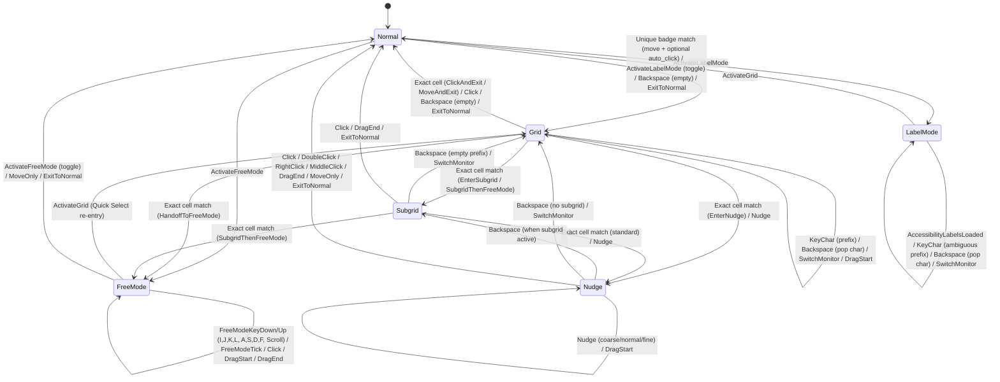

# 02 — Core Engine & Algorithms (`ratpoison-core`)

> **Crate:** `crates/ratpoison-core`  
> **Safety & Purity:** `#![forbid(unsafe_code)]`, zero OS/IO/clock calls, 100% deterministic pure functions & state transitions.

---

## 1. Architecture Overview

`ratpoison-core` is the pure algorithmic kernel of RatPoison. Platform crates (`ratpoison-hid`, `ratpoison-a11y`, `src-tauri`) translate OS events into [`EngineEvent`] values, step [`CoreEngine::handle_event`], and execute the returned [`EngineEffect`] descriptors while forwarding [`OverlaySnapshot`] to the Tauri frontend via the `ratpoison://overlay-state` event.

| Module | File | Responsibility |
| --- | --- | --- |
| `geometry` | `crates/ratpoison-core/src/geometry.rs` | `MonitorInfo`, `MonitorLayout`, mixed-DPI `logical_to_physical` / `physical_to_logical`, edge-safe clamping, L-shaped desktop projection, directional monitor switching |
| `grid` | `crates/ratpoison-core/src/grid.rs` | Configurable NxM grid & nested subgrid subdivision, custom/case-sensitive alphabets (> 676 cells), prefix matching, coarse/normal/fine nudge math |
| `presets` | `crates/ratpoison-core/src/presets.rs` | Quick Select + Free Mode `WorkflowPreset`, `FreeModeProfile` velocity/acceleration curves, per-app / per-monitor override resolution |
| `config` | `crates/ratpoison-core/src/config.rs` | `RatPoisonConfig` with lossless `#[serde(flatten)] unknown_fields` preservation and single-key `restore_default(key)` |
| `state_machine` | `crates/ratpoison-core/src/state_machine.rs` | Pure `CoreEngine` handling `Normal -> Grid -> Subgrid -> Nudge`, `Normal <-> FreeMode`, `Normal <-> LabelMode`, emitting `EngineEffect` + `OverlaySnapshot` |
| `error` | `crates/ratpoison-core/src/error.rs` | Typed `CoreError` (`thiserror`) |

---

## 2. Multi-Monitor Mixed-DPI Coordinate Math

### 2.1 Why Per-Monitor Local Affine Transforms Are Required

In mixed-DPI multi-monitor arrangements (e.g., a `1.25x` monitor placed at negative `x` to the left of a `2.0x` Retina primary monitor, or a `1.5x` monitor above it), multiplying global logical coordinates directly by `scale_factor` produces incorrect physical pixels because each monitor's origin already reflects different neighbor scales.

Every [`MonitorInfo`] therefore carries:
- `logical_rect`: `(L_x, L_y, L_w, L_h)` in `f64` logical points
- `physical_rect`: `(P_x, P_y, P_w, P_h)` in `i32`/`u32` device pixels
- `scale_factor`: `s > 0` (`f64`, e.g., `1.0`, `1.25`, `1.5`, `1.75`, `2.0`)
- `is_primary`: `bool`
- Derived `Orientation`: `Portrait` when `L_h > L_w`, else `Landscape`

### 2.2 Forward & Inverse Coordinate Transforms

For a point on monitor `M`:

- **Logical → Physical (`logical_to_physical`):**
  $$x_P = P_x + \operatorname{round}\!\big((x_L - L_x) \cdot s\big), \qquad y_P = P_y + \operatorname{round}\!\big((y_L - L_y) \cdot s\big)$$
  Saturated safely into `i32` bounds; `logical_to_physical_clamped` additionally clamps to `[P_x, P_x + P_w - 1] × [P_y, P_y + P_h - 1]`.

- **Physical → Logical (`physical_to_logical`):**
  $$x_L = L_x + \frac{x_P - P_x}{s}, \qquad y_L = L_y + \frac{y_P - P_y}{s}$$
  Computed using `i64` subtraction before `f64` division to prevent `i32` overflow on negative origins.

- **Exact Round-Trip Invariant:** For every physical pixel `p` on monitor `M`:
  $$\operatorname{logical\_to\_physical}\!\big(\operatorname{physical\_to\_logical}(p, M), M\big) = p$$
  holds identically across `1.0x`, `1.25x`, `1.5x`, `2.0x`, negative origins, and portrait/landscape displays.

### 2.3 Edge-Safe Monitor Clamping & L-Shaped Virtual Desktop Projection

1. **Half-open monitor ownership:** `LogicalRect::contains_point` uses `[L_x, L_x + L_w) × [L_y, L_y + L_h)` so shared monitor seams never belong to two displays.
2. **Last-pixel logical upper bound:** Clamping a logical coordinate inside monitor `M` uses:
   $$x_{\max}(M) = \min\!\left(L_x + \frac{P_w - 1}{s},\; L_x + L_w\right)$$
   At `1.25x` (`L_w = 1536`, `P_w = 1920`), `x_max = 1535.2 < 1536.0`, which maps cleanly to pixel `1919` without ever spilling onto an adjacent display at `x = 1536.0`.
3. **Virtual desktop union clamping (`MonitorLayout::clamp_logical_to_virtual_desktop`):** For non-rectangular L-shaped or staggered monitor setups, out-of-bounds points are projected onto the closest point in the union of all monitors (breaking ties in favor of the primary display) rather than clamping to the bounding box's dead corners.
4. **Directional monitor switching (`MonitorLayout::neighbor_in_direction`):** A candidate monitor matches direction `u` only if its center lies inside the ±45° forward cone (`perpendicular <= forward`) or its rect lies strictly beyond the active monitor's edge in direction `u`, ranked by `forward + 2 * perpendicular`. This prevents tall portrait side monitors from falsely matching `Up`/`Down`.

---

## 3. Configurable NxM Grid, Nested Subgrid & Nudge Math

### 3.1 Zero-Gap Edge-Exact Cell Tiling

Given bounds `(B_x, B_y, B_w, B_h)` and dimensions `cols × rows`, cell `(row, col)` computes edges directly from integer indices rather than cumulative addition:

$$x_0 = B_x + \frac{\text{col} \cdot B_w}{\text{cols}}, \qquad x_1 = \begin{cases} B_x + B_w & \text{if } \text{col} + 1 = \text{cols} \\ B_x + \frac{(\text{col} + 1) \cdot B_w}{\text{cols}} & \text{otherwise} \end{cases}$$

and analogously for `y_0, y_1`, with `center = ((x_0 + x_1)/2, (y_0 + y_1)/2)`. This eliminates floating-point gap drift across negative origins and non-divisible widths (e.g., `1440 / 7`).

### 3.2 Label Schemes & > 676 Cell Support

[`LabelScheme`] supports:
- **Standard lowercase `a-z`** (`case_sensitive = false`): 26 keys → up to **676** two-character labels.
- **Mixed-case `a-zA-Z`** (`LabelScheme::mixed_case_az()`, `case_sensitive = true`): 52 keys → up to **2,704** unique two-character labels.
- **Custom key-row layouts** (`LabelScheme::from_key_rows`, `LabelScheme::qwerty_rows`): e.g., 30-key QWERTY/Colemak rows (900 labels case-insensitive; **3,600** labels case-sensitive).
- **Distinct `second_alphabet`**: optional separate second-character keyset (e.g., left-hand rows followed by right-hand columns).
- **Label ordering (`LabelOrdering`):**
  - `RowColIndexed` (default): assigns `(first[row], second[col])` when `rows <= |first|` and `cols <= |second|`, and automatically falls back to `Sequential` for oversized grids (e.g., `20 × 55 = 1,100` cells) so any grid within `|first| * |second|` succeeds cleanly.
  - `Sequential`: row-major Cartesian enumeration over `first × second`.
- Capacity overflow returns `CoreError::InsufficientLabelCapacity { required, available }` deterministically instead of panicking or emitting duplicate labels.

### 3.3 Nested Subgrid Subdivision

`generate_subgrid(parent_cell, monitor_id, config)` subdivides `parent_cell.rect` into `subgrid_cols × subgrid_rows` (default `3 × 3` labeled with single-key left-hand cluster `q w e / a s d / z x c`). If `subgrid_cols * subgrid_rows > subgrid_keys.len()`, it automatically falls back to `label_scheme` (1-char if sufficient, else 2-char).

### 3.4 Precision Nudge Math

[`NudgeConfig`] defines three logical pixel distances (`coarse_px = 24.0`, `normal_px = 8.0`, `fine_px = 1.5`) and [`NudgeClampMode`]:
- `ActiveMonitor`: clamps strictly to the active monitor's `[L_x, x_max] × [L_y, y_max]`.
- `VirtualDesktop`: allows nudging seamlessly across monitor seams, clamping to the virtual desktop union and returning the updated owning `monitor_id`.
- `Unclamped`: passes raw coordinates through.

---

## 4. Mode State Machine

### 4.1 State Transition Diagram



### 4.2 Drag-and-Drop Safety Invariant

- `MouseActionKind::DragStart` emits `EngineEffect::MouseDown { button: Left, .. }`, sets `dragging = true`, and keeps the current navigation mode active so the user can jump across cells or monitors to the drop target.
- `MouseActionKind::DragEnd` emits `EngineEffect::MouseUp { button: Left, .. }`, clears `dragging = false`, and returns to `Normal` (or remains in `FreeMode` if triggered inside `FreeMode`).
- `EngineEvent::ExitToNormal` (Escape) **always** emits `EngineEffect::MouseUp` if `dragging == true` so the OS pointer can never get stuck in a dragged state.

### 4.3 Free Mode Physics & Acceleration Curves

`FreeMode` is overlay-free (`visible = false`) and clock-independent: callers drive motion by passing elapsed milliseconds via `EngineEvent::FreeModeTick { dt_ms }`.

- **Keys (`FreeKey`):** `I/J/K/L` (directional steering), `ScrollUp/Down/Left/Right`, and speed modifiers `A` (`Slow`), `S` (`Normal`), `D` (`Fast`), `F` (`Turbo`).
- **Modifier precedence:** Held speed modifiers are maintained in a last-pressed stack (`speed_stack`). Releasing the top modifier cleanly restores the previous held modifier (defaulting to `Normal` when empty).
- **Power ease-in acceleration curve:** For continuous hold time $t$ (`move_hold_ms`), ramp duration $T_{\text{ramp}}$ (`ramp_ms`), and exponent $p$ (`curve_exponent`, default `1.6`):
  $$u = \operatorname{clamp}\!\left(\frac{t}{T_{\text{ramp}}},\; 0,\; 1\right), \qquad v(t) = v_{\text{base}} + (v_{\text{max}} - v_{\text{base}}) \cdot u^p$$
  Default tiers (logical px/s):
  - `Slow (A)`: `60 → 140`
  - `Normal (S)`: `240 → 650`
  - `Fast (D)`: `550 → 1400`
  - `Turbo (F)`: `1100 → 2600`
- **Diagonal normalization:** When `normalize_diagonal == true` and both horizontal and vertical movement keys are held, `(dx, dy)` is multiplied by $1/\sqrt{2}$ so diagonal speed matches cardinal speed.
- **Cross-monitor traversal:** When `allow_cross_monitor == true`, coordinates clamp via `MonitorLayout::clamp_logical_to_virtual_desktop`, smoothly updating `active_monitor_id` and emitting target-monitor physical pixel coordinates as the cursor crosses DPI seams.

---

## 5. Quick Select + Free Mode Preset Workflow

### 5.1 Data Model (`presets.rs`)

A [`WorkflowPreset`] unifies grid density, post-selection handoff, Free Mode physics, nudge distances, and optional override scoping:

```rust
pub struct WorkflowPreset {
    pub id: String,
    pub name: String,
    pub description: String,
    pub grid: GridConfig,
    pub quick_select_action: QuickSelectAction, // EnterSubgrid | HandoffToFreeMode | SubgridThenFreeMode | EnterNudge | ClickAndExit | MoveAndExit
    pub free_mode: FreeModeProfile,
    pub nudge: NudgeConfig,
    pub priority: i32,
    pub scope: PresetOverrideScope,             // app_ids, monitor_ids, orientation
    pub unknown_fields: BTreeMap<String, serde_json::Value>,
}
```

Three built-in presets ship via `default_presets()`:
1. **`"standard"`**: `16 × 12` 2-key grid → `3 × 3` subgrid → `Nudge`.
2. **`"quick_select_free"`**: `6 × 4` single-key coarse grid (24 zones) with `QuickSelectAction::HandoffToFreeMode` — one keypress teleports to the coarse screen zone, hides the overlay, and drops straight into `FreeMode` for micro-positioning.
3. **`"precision_design"`**: `16 × 10` grid with `QuickSelectAction::SubgridThenFreeMode` and low-speed precision Free Mode curves (ideal for CAD/Figma overrides).

### 5.2 Deterministic Override Resolution (`resolve_preset`)

When activating Grid or Free Mode, presets resolve deterministically in strict order:
1. Explicit `preset_id` passed in the event (e.g., dedicated Quick Select global hotkey).
2. Highest-specificity matching scoped preset:
   - `app_ids` match (case-insensitive): `+4`
   - `monitor_ids` match: `+2`
   - `orientation` match: `+1`
   - Tie-break: higher `priority`, then lexicographically smaller `id`.
3. `config.active_preset_id`.
4. First preset in `config.presets`.

---

## 6. Config Schema, Unknown-Field Preservation & Single-Key Reset

[`RatPoisonConfig`] and every nested config struct (`GridConfig`, `LabelScheme`, `NudgeConfig`, `FreeModeProfile`, `LabelModeConfig`, `OverlayConfig`, `HotkeyConfig`, `WorkflowPreset`, `PresetOverrideScope`) carry:

```rust
#[serde(flatten, default)]
pub unknown_fields: BTreeMap<String, serde_json::Value>,
```

- **Zero data loss:** Future/plugin/custom JSON keys at top-level or inside any nested section survive `from_json_str` → edit / `restore_default` → `to_json_string_pretty` untouched.
- **Single-key right-click reset (`restore_default(key)`):** Directly backs the `reset_setting_key` Tauri command. Accepts any dot-notation path in `KNOWN_SETTING_KEYS` (e.g. `"grid.cols"`, `"grid.label_scheme.case_sensitive"`, `"nudge.fine_px"`, `"free_mode.ramp_ms"`, `"overlay.opacity"`, `"hotkeys.quick_select"`, or whole sections like `"grid"` while preserving `unknown_fields`). Returns `Err(CoreError::UnknownSettingKey)` on unrecognized keys.

---

## 7. Public Rust API Surface & IPC Payloads

### 7.1 Crate Root Re-Exports (`use ratpoison_core::*;`)

- **Geometry:** `Direction`, `Orientation`, `LogicalPoint`, `PhysicalPoint`, `LogicalRect`, `PhysicalRect`, `MonitorInfo`, `MonitorLayout`, `logical_to_physical`, `logical_to_physical_clamped`, `physical_to_logical`, `clamp_logical_to_monitor`.
- **Grid & Nudge:** `LabelOrdering`, `LabelScheme`, `GridConfig`, `GridCell`, `Grid`, `PrefixMatch`, `NudgeStep`, `NudgeClampMode`, `NudgeConfig`, `default_subgrid_keys`, `generate_grid`, `generate_grid_in_rect`, `generate_subgrid`, `generate_subgrid_in_rect`, `nudge_in_direction`, `nudge_by_vector`.
- **Presets & Physics:** `MouseButton`, `SpeedModifier`, `SpeedTier`, `FreeModeProfile`, `QuickSelectAction`, `PresetOverrideScope`, `WorkflowPreset`, `default_presets`, `resolve_preset`.
- **Config:** `RatPoisonConfig`, `LabelModeConfig`, `OverlayConfig`, `HotkeyConfig`, `KNOWN_SETTING_KEYS`.
- **State Machine:** `CoreEngine`, `EngineMode`, `EngineEvent`, `EngineEffect`, `StepOutput`, `OverlaySnapshot`, `ActiveModifiers`, `LabelBadge`, `MonitorSwitch`, `MouseActionKind`, `FreeKey`.
- **Errors:** `CoreError`.

### 7.2 `ratpoison://overlay-state` JSON Payload (`OverlaySnapshot`)

```json
{
  "mode": "subgrid",
  "visible": true,
  "active_monitor_id": "DP-1",
  "active_monitor": {
    "id": "DP-1",
    "name": "Retina Primary",
    "logical_rect": { "x": 0.0, "y": 0.0, "width": 1440.0, "height": 900.0 },
    "physical_rect": { "x": 0, "y": 0, "width": 2880, "height": 1800 },
    "scale_factor": 2.0,
    "is_primary": true
  },
  "grid_cells": [
    {
      "label": "aa",
      "row": 0,
      "col": 0,
      "rect": { "x": 0.0, "y": 0.0, "width": 90.0, "height": 75.0 },
      "center": { "x": 45.0, "y": 37.5 }
    }
  ],
  "subgrid_rect": { "x": 0.0, "y": 0.0, "width": 90.0, "height": 75.0 },
  "subgrid_cells": [
    {
      "label": "q",
      "row": 0,
      "col": 0,
      "rect": { "x": 0.0, "y": 0.0, "width": 30.0, "height": 25.0 },
      "center": { "x": 15.0, "y": 12.5 }
    }
  ],
  "label_badges": [],
  "typed_prefix": "",
  "cursor_preview": { "x": 45.0, "y": 37.5 },
  "active_modifiers": {
    "speed": "normal",
    "speed_keys_held": [],
    "nudge_step": "normal",
    "dragging": false
  },
  "active_preset_id": "standard"
}
```

### 7.3 Integration Notes for Other Swarm Crates

- **`ratpoison-hid`**: Forward intercepted keyboard/hotkey events into `CoreEngine::handle_event`, drive `FreeModeTick { dt_ms }` on a fixed timer (e.g., 8 ms / 120 Hz) only while `engine.mode() == EngineMode::FreeMode`, and execute `MoveCursor` (using `physical`), `Click`, `MouseDown`, `MouseUp`, and `Scroll` effects.
- **`ratpoison-a11y`**: On `EngineEffect::QueryAccessibility { monitor_id }`, collect visible interactive UI nodes in logical coordinates for that monitor and feed `EngineEvent::AccessibilityLabelsLoaded { badges }`. Leave `LabelBadge::label` empty if you want `ratpoison-core` to auto-assign prefix-safe labels.
- **`frontend` / `src-tauri`**: Listen to `ratpoison://overlay-state` (`OverlaySnapshot`) and `ratpoison://config-updated` (`RatPoisonConfig`). Bind the Settings UI right-click "Restore Default" action to `reset_setting_key(key)` → `RatPoisonConfig::restore_default(&key)`.
