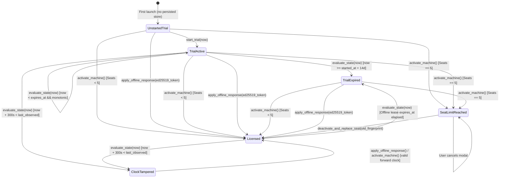
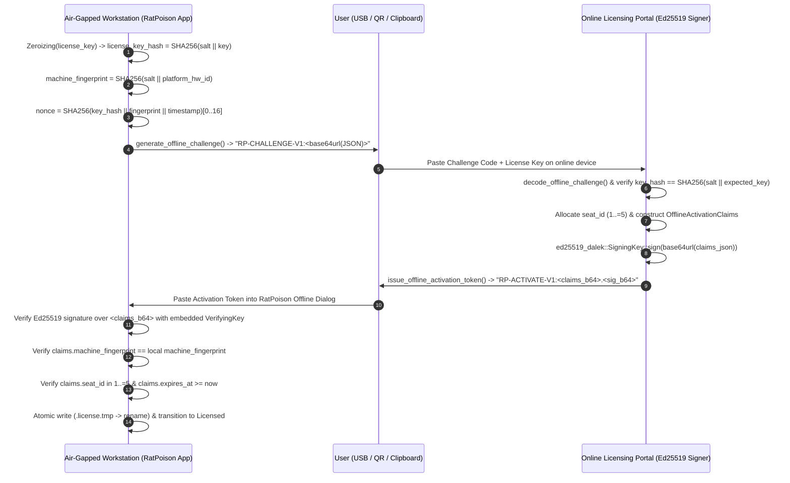

# 05 — Licensing, In-Place Update Architecture & Cross-Platform CI/CD

**Owner:** Sub-Agent 5 (Licensing, Update & DevOps Agent)  
**Crate:** [`crates/ratpoison-license/`](file:///Users/abelmora/Documents/Avalon/RatPoison/crates/ratpoison-license/src/lib.rs)  
**CI/CD Workflow:** [`.github/workflows/release.yml`](file:///Users/abelmora/Documents/Avalon/RatPoison/.github/workflows/release.yml)

---

## 1. Licensing State Machine (`LicenseManager`)

RatPoison mirrors and hardens the Mouseless commercial licensing model with a **14-day evaluation trial**, a **5-machine seat limit (`MAX_MACHINES = 5`)**, an interactive **Deactivation Dialog flow** when all 5 seats are occupied, and an **Offline / Air-Gapped Ed25519 Challenge-Response activation flow**.

### 1.1 Licensing State Machine Diagram

### 1.2 14-Day Trial & Monotonic Clock-Rollback Guard
- **Duration:** `TRIAL_DURATION_DAYS = 14` (`1,209,600` seconds).
- **Remaining Days Calculation:** Uses ceiling division (`remaining_seconds.div_ceil(86_400)`) so day 1 displays `14 days remaining` and the final 24-hour window displays `1 day remaining` until exact expiry.
- **Clock Tamper Detection:** Every state evaluation compares `current_timestamp` against `store.last_observed_timestamp`. Minor NTP drift up to `CLOCK_ROLLBACK_TOLERANCE_SECS = 300` (5 minutes) is tolerated; any backward jump exceeding 300 seconds immediately transitions the state machine to `LicenseState::ClockTampered` and returns `LicenseError::ClockRollbackDetected`.

### 1.3 Privacy-Preserving Hardware Fingerprinting & Memory Hygiene
- **No Raw Serial Transmission:** Platform identifiers (`/etc/machine-id`, `IOPlatformUUID`, Windows `MachineGuid`) are read into a `zeroize::Zeroizing<String>` buffer and immediately hashed with a domain-separated salt:
  $$\text{Fingerprint} = \text{Hex}\left(\text{SHA-256}(\texttt{"ratpoison.mouseless.hardware-fingerprint.v1:"} \parallel \text{raw\_id})\right)$$
- **Zeroization of License Keys:** Raw license keys passed to `activate_machine`, `deactivate_and_replace_seat`, or `generate_offline_challenge` are wrapped in `zeroize::Zeroizing<String>` and hashed via `SHA-256("ratpoison.mouseless.license-key-hash.v1:" || canonical_uppercase_key)` before storage or challenge generation. Plaintext license keys are never persisted to disk or embedded in offline challenge codes.

### 1.4 5-Machine Seat Limit & Deactivation Dialog Flow
- Each license key hash governs a pool of at most `MAX_MACHINES = 5` concurrent seats (`seat_id` $\in \{1, 2, 3, 4, 5\}$).
- Re-activating a machine whose `machine_fingerprint` is already in `active_seats` is idempotent: it refreshes `last_seen`, updates `friendly_hostname`/`os`, and returns `ActivationOutcome::Activated`.
- When all 5 seats are occupied and a 6th distinct `machine_fingerprint` attempts activation, `LicenseManager::activate_machine` transitions to `LicenseState::SeatLimitReached` and returns `ActivationOutcome::RequiresDeactivation { prompt: DeactivationPrompt }`.
- `DeactivationPrompt` provides the Tauri React UI with:
  - `max_machines: 5`
  - `attempting_machine`: summary of the new workstation requesting a seat
  - `occupied_seats`: all 5 active `MachineSeat` records (`seat_id`, `friendly_hostname`, `os`, `activated_at`, `last_seen`, `machine_fingerprint`)
- When the user selects an old workstation in the modal and invokes `deactivate_and_replace_seat(license_key, target_fingerprint_to_deactivate, now)`, the old seat is evicted and its `seat_id` is atomically reassigned to the current machine.

---

## 2. Offline / Air-Gapped Ed25519 Challenge-Response Protocol

For enterprise or high-security environments with zero outbound internet connectivity, RatPoison supports full cryptographic offline activation using `ed25519-dalek`.

### 2.1 Protocol Sequence Diagram

### 2.2 Wire Formats
1. **Challenge Code (`RP-CHALLENGE-V1:<base64url>`):**
   - Encodes `OfflineChallengePayload { version: 1, license_key_hash, machine_fingerprint, friendly_hostname, os, timestamp, nonce }`.
2. **Signed Activation Token (`RP-ACTIVATE-V1:<claims_b64>.<signature_b64>`):**
   - `<claims_b64>` is the Base64URL-encoded JSON of `OfflineActivationClaims { version: 1, license_key_hash, machine_fingerprint, seat_id, issued_at, expires_at, challenge_nonce }`.
   - `<signature_b64>` is the 64-byte Ed25519 signature computed over the exact ASCII bytes of `<claims_b64>`.
3. **Tamper Resistance:**
   - Modifying any byte in `<claims_b64>` or `<signature_b64>` fails Ed25519 verification (`LicenseError::SignatureVerificationFailed`).
   - Replaying a valid token on another machine fails hardware binding (`LicenseError::FingerprintMismatch`).

---

## 3. Cross-Platform In-Place Update Architecture (`updater.rs`)

`ratpoison-license::updater` implements Semantic Versioning 2.0.0 ordering (`SemVer`), channel filtering (`UpdateChannel::Stable` vs `UpdateChannel::Beta`), Tauri v2 JSON manifest parsing (`TauriUpdateManifest`), and cryptographic signature verification (`verify_artifact_signature_metadata`).

### 3.1 Updater Mechanism Comparison & OS Strategy

| Platform | Primary Update Engine | Native Alternative Supported | Package Format & Verification | Sandbox / Permission Constraints |
| :--- | :--- | :--- | :--- | :--- |
| **macOS** (`aarch64` + `x86_64` Universal) | **Tauri v2 Updater** (`tauri-plugin-updater`) | **Sparkle 2** (`UpdateBackend::SparkleAppcast`) | `.app.tar.gz` + `.sig` (Ed25519) + Apple Developer ID + Notarization staple | Preserves macOS TCC Accessibility (`AXIsProcessTrusted`) and Input Monitoring permissions across in-place `.app` replacement as long as Bundle ID (`io.github.emrisca.RatPoison`) and Developer ID Team ID remain identical. |
| **Windows** (`x86_64-pc-windows-msvc`) | **Tauri v2 Updater** (`tauri-plugin-updater`) | **WinSparkle / Omaha** (`UpdateBackend::WinSparkleOmaha`) | `.msi.zip` / `.nsis.zip` + `.sig` (Ed25519) + Authenticode SHA-256 (`signtool`) | Runs passive MSI/NSIS replacement (`msiexec /i /quiet`); if UIAccess / elevated binary resides in `C:\Program Files`, triggers a single UAC elevation prompt during swap. |
| **Linux (AppImage / .deb)** | **Tauri v2 Updater** (`tauri-plugin-updater`) | APT / system repository | `.AppImage.tar.gz` + `.sig` (Ed25519) + `SHA256SUMS.txt.asc` (GPG) | AppImage replaces the user-writable binary atomically and restarts via `execv`. |
| **Linux (Flatpak)** | **Flatpak OSTree / Flathub** (`UpdateBackend::FlatpakOstree`) | System Software Center (`gnome-software` / `discover`) | OSTree signed commit deltas (`io.github.emrisca.RatPoison`) | Inside a Flatpak sandbox (`/.flatpak-info` or `FLATPAK_ID` present), `/app` is mounted read-only. `evaluate_update(..., is_flatpak_sandbox: true)` returns `UpdateCheckDecision::ManagedByPackageManager` and instructs the user to run `flatpak update io.github.emrisca.RatPoison`. |

---

## 4. CI/CD Release Pipeline & Secrets Outline (`.github/workflows/release.yml`)

Triggered automatically on `v*.*.*` git tags (e.g., `v0.1.0` for `stable` or `v0.2.0-beta.1` for `beta`) or manual `workflow_dispatch`.

### 4.1 Pipeline Stages
1. **`verify-crates` (`ubuntu-22.04`):** Runs `cargo test -p ratpoison-license --all-targets` to gate the release on trial, 5-machine seat limit, clock-rollback, Ed25519 offline challenge-response, and updater manifest verification tests.
2. **`build-macos` (`macos-14`):**
   - Compiles universal macOS binary (`--target universal-apple-darwin` combining `aarch64-apple-darwin` and `x86_64-apple-darwin`).
   - Imports Developer ID Application `.p12` certificate into an ephemeral build keychain.
   - Signs `.app` and `.dmg`, submits to Apple Notary Service via `xcrun notarytool submit --wait`, staples the ticket via `xcrun stapler staple`, verifies Gatekeeper assessment via `spctl --assess`, and emits `.app.tar.gz.sig`.
3. **`build-windows` (`windows-2022`):**
   - Compiles `x86_64-pc-windows-msvc` `.msi` and NSIS `.exe` installers plus `.sig` updater bundles.
   - Authenticode-signs all `.exe` and `.msi` binaries using `signtool.exe sign /fd SHA256 /tr http://timestamp.digicert.com /td SHA256` and verifies with `signtool.exe verify /pa`.
4. **`build-linux` (`ubuntu-22.04`):**
   - Compiles `.AppImage`, `.deb`, and `.AppImage.tar.gz.sig`.
   - Builds the Flatpak OSTree repository and single-file bundle (`RatPoison-x86_64.flatpak`) from `packaging/flatpak/io.github.emrisca.RatPoison.yml` if present.
5. **`publish-release` (`ubuntu-22.04`):**
   - Aggregates all artifacts, computes `SHA256SUMS.txt`, signs `SHA256SUMS.txt.asc` with the release GPG key, generates `latest.json` with channel auto-detection (`stable` vs `beta`), and publishes the GitHub Release via `softprops/action-gh-release@v2`.

### 4.2 Required GitHub Actions Repository Secrets

| Secret Name | Platform | Purpose |
| :--- | :--- | :--- |
| `TAURI_SIGNING_PRIVATE_KEY` | All | Ed25519/Minisign private key used by `cargo tauri build` to generate `.sig` updater signatures. |
| `TAURI_SIGNING_PRIVATE_KEY_PASSWORD` | All | Passphrase unlocking `TAURI_SIGNING_PRIVATE_KEY`. |
| `APPLE_CERTIFICATE` | macOS | Base64-encoded Developer ID Application `.p12` certificate. |
| `APPLE_CERTIFICATE_PASSWORD` | macOS | Passphrase for decoding the `.p12` certificate. |
| `APPLE_SIGNING_IDENTITY` | macOS | Common Name (e.g., `"Developer ID Application: Emrisca (TEAMID)"`). |
| `APPLE_ID` / `APPLE_PASSWORD` / `APPLE_TEAM_ID` | macOS | App-specific credentials for `xcrun notarytool` notarization. |
| `SPARKLE_ED25519_PRIVATE_KEY` | macOS | Optional native Sparkle 2 Ed25519 signing key for appcast enclosure signatures. |
| `WINDOWS_PFX_BASE64` / `WINDOWS_PFX_PASSWORD` | Windows | Base64-encoded Authenticode `.pfx` certificate and password for `signtool.exe`. |
| `GPG_PRIVATE_KEY` / `GPG_PASSPHRASE` | Linux / Release | Armored GPG private key and passphrase for signing `SHA256SUMS.txt.asc`. |
